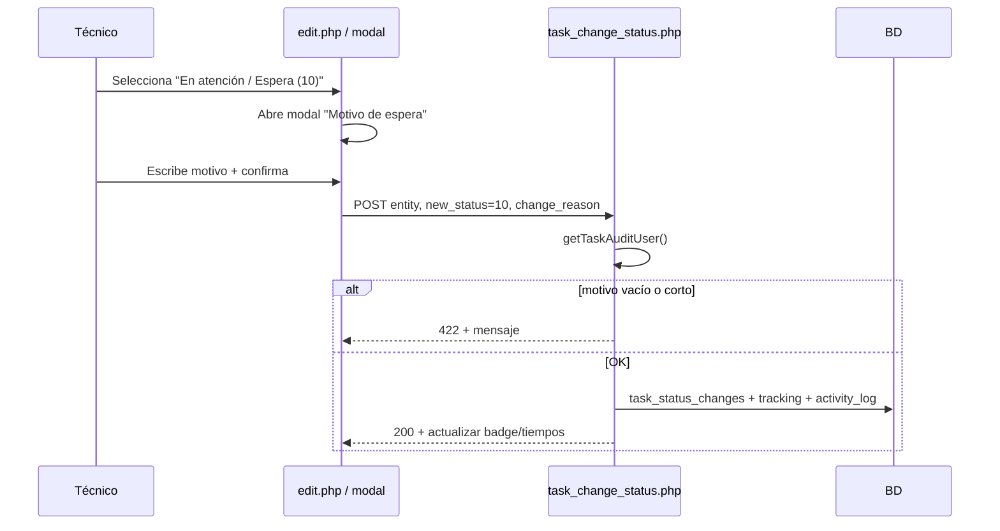
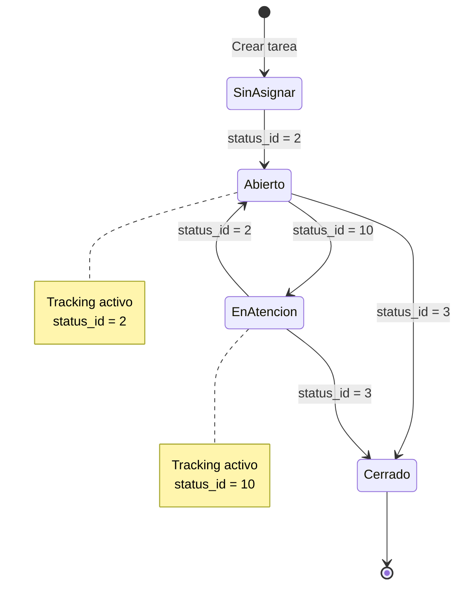

# Propuesta: Módulo de Tareas

**Ubicación:** `tickets/modules/task/`  
**Fecha:** Mayo 2026 (actualización v2)  
**Referencia base:** `tickets/modules/tickets/new.php`, `edit.php`, `ticket_status_tracking.php`, `ticket_history.php`

---

## 1. Resumen ejecutivo

Se propone un **nuevo apartado de Tareas** dentro del sistema de tickets, independiente del flujo de tickets por correo pero **reutilizando los mismos catálogos y datos de alta** que `new.php` (categoría, estado, solicitante, técnico, prioridad, descripción, etc.).

Cada **tarea principal** podrá contener **subtareas** asignables a distintos técnicos. El módulo usará la **misma tabla de estados** (`statuses`) y un **seguimiento de tiempo** equivalente al de tickets, ampliado para registrar tiempo en:

| `status_id` | Nombre habitual        | ¿Registrar tiempo? | Regla adicional |
|-------------|------------------------|--------------------|-----------------|
| **2**       | Abierto                | Sí                 | — |
| **10**      | En atención / Espera   | Sí                 | **Motivo obligatorio** al entrar a este estado |
| **3**       | Cerrado                | Cierra períodos activos | Retroalimentación del técnico recomendada/obligatoria |

### Novedades v2 (requerimiento actual)

1. **Retroalimentación por técnico:** cada técnico asignado a su subtarea puede registrar **qué hizo / su solución** (bitácora de trabajo), visible en la tarea.
2. **Motivo al pasar a estado 10:** al cambiar a **En atención / Espera**, el sistema **exige** una descripción del porqué (modal o campo obligatorio).
3. **Auditoría de usuario:** **todo** cambio relevante (estado, motivo, retroalimentación, asignación, cierre) guarda **quién lo hizo** — usuario de sesión (`getUserName()` + `user_id` de `$_SESSION['user']`).

Al salir de 2 o 10, o al cerrar la tarea/subtarea, se **cierra el período** y se guarda `duration_minutes` en historial.

---

## 2. Objetivos

1. Permitir planificar y dar seguimiento a trabajo interno (tareas) sin mezclarlo con el hilo de correos de tickets.
2. Reutilizar formularios y reglas de negocio ya conocidas por el usuario (misma experiencia que crear ticket).
3. Descomponer trabajo en **subtareas** con responsable (técnico) propio.
4. Medir tiempos en estados **Abierto (2)** y **En atención / Espera (10)** para reportes y control operativo.
5. Respetar **multi-empresa** (`id_empresa`) y permisos actuales del módulo tickets.
6. **Registrar la solución o avance** de cada técnico en su subtarea como retroalimentación trazable.
7. **Obligar justificación** al mover a estado 10 (espera / dependencia / bloqueo).
8. Garantizar **trazabilidad completa** del usuario que ejecutó cada acción en el módulo.

---

## 3. Alcance funcional

### 3.1 Incluido en la propuesta

- CRUD de tareas principales.
- CRUD de subtareas (dentro de una tarea).
- Asignación de técnico por subtarea (y técnico responsable opcional en tarea padre).
- Mismos `status_id` que tickets (tabla `statuses`).
- Tracking de tiempo por cambio de estado (2, 10 y cierre).
- **Retroalimentación / solución del técnico** por subtarea (bitácora con autor y fecha).
- **Motivo obligatorio** al cambiar a `status_id = 10`.
- **Registro de usuario** en cada cambio (sesión activa).
- Listado, filtros y vista detalle (estilo `modern-tickets.php` / `edit.php`).
- Historial unificado de actividad (auditoría).
- Integración en menú lateral (`modern-sidebar.php`).

### 3.3 Fuera de alcance inicial (fases posteriores)

- Envío de correos automáticos (como `new.php` / `edit.php`); se puede agregar después.
- Dependencias entre subtareas (Gantt / bloqueos).
- App móvil o API REST dedicada.
- Sincronización tarea ↔ ticket existente (vínculo opcional en fase 2).

---

## 4. Datos de alta (paridad con `new.php`)

La creación de tarea reutilizará los **mismos campos y catálogos** que `tickets/modules/tickets/new.php`:

| Campo / catálogo        | Tabla origen      | Uso en tarea                          |
|-------------------------|-------------------|----------------------------------------|
| `category_id`           | `categories`      | Clasificación                          |
| `status_id`             | `statuses`        | Estado actual (misma lista)            |
| `contact_mode_id`       | `contact_modes`   | Medio de contacto                      |
| `level_id`              | `levels`          | Nivel                                  |
| `impact_id`             | `impacts`         | Impacto                                |
| `urgency_id`            | `urgencies`       | Urgencia                               |
| `priority_id`           | `priorities`      | Prioridad                              |
| `impact_details`        | —                 | Detalle de impacto                     |
| `requester_id`          | `requesters`      | Solicitante / área que pide la tarea   |
| `classification_id`     | `classifications` | Clasificación                          |
| `technician_id`         | `technicians`     | Técnico responsable de la tarea padre  |
| `description`           | —                 | Descripción (obligatoria)              |
| `resolution`            | —                 | Resolución al cerrar                   |
| `id_empresa`            | —                 | Empresa (sesión / helper)              |

**Nota:** En tickets, el alta manual usa contador `ticket_number`. Para tareas se propone un folio propio: `task_number` (ej. `TAR-2026-0001`) con tabla `task_counters` por empresa, análoga a `carta_entrega_counters` / tickets.

### 4.1 Subtareas (campos propuestos)

| Campo              | Tipo        | Descripción                                      |
|--------------------|-------------|--------------------------------------------------|
| `id`               | PK          | Identificador                                    |
| `task_id`          | FK          | Tarea padre                                      |
| `title`            | VARCHAR     | Título corto de la subtarea                      |
| `description`      | TEXT        | Detalle opcional (alcance inicial)               |
| `technician_id`    | FK          | Técnico asignado (obligatorio al crear)          |
| `status_id`        | FK          | Mismo catálogo `statuses`                        |
| `sort_order`       | INT         | Orden en la lista                                |
| `created_at`       | TIMESTAMP   | Alta                                             |
| `updated_at`       | DATETIME    | Última modificación                              |
| `closed_at`        | TIMESTAMP   | Cierre (status 3)                                |
| `created_by`       | VARCHAR     | Usuario de sesión que creó (`getUserName()`)     |
| `created_by_user_id` | INT NULL  | ID usuario `$_SESSION['user']['id']`             |
| `updated_by`       | VARCHAR     | Último usuario que modificó                        |
| `updated_by_user_id` | INT NULL  | ID del último modificador                        |

Cada subtarea tiene **su propio** `status_id` y **su propio** tracking de tiempo (ver sección 6).

### 4.2 Retroalimentación del técnico (solución / qué se hizo)

No se sobrescribe un solo campo: se guarda una **bitácora** para mantener historial y saber quién escribió cada avance.

| Campo                 | Tipo      | Descripción |
|-----------------------|-----------|-------------|
| `subtask_id`          | FK        | Subtarea |
| `technician_id`       | FK        | Técnico que reporta (debe coincidir con asignado, salvo admin) |
| `work_feedback`       | TEXT      | **Solución, avance o retroalimentación** de lo realizado |
| `created_by`          | VARCHAR   | Usuario de sesión que registró el texto |
| `created_by_user_id`  | INT       | ID usuario de sesión |
| `created_at`          | TIMESTAMP | Fecha/hora del registro |

**Reglas UX:**

- El técnico asignado ve en su subtarea el bloque **“Mi retroalimentación / Lo que hice”** con botón **Agregar avance**.
- Puede haber **varias entradas** (cronología); la más reciente se resalta en el listado.
- Al **cerrar** subtarea (status 3), se recomienda exigir al menos **una** entrada de retroalimentación del técnico asignado (configurable: obligatorio en MVP).

### 4.3 Cambio a estado 10 — motivo obligatorio

Al seleccionar **En atención / Espera** (`status_id = 10`), el sistema muestra un **modal** o panel con:

| Campo | Obligatorio | Ejemplo |
|-------|-------------|---------|
| `waiting_reason` | **Sí** (mín. 10 caracteres) | “Esperando respuesta del proveedor de red” |
| Confirmación de cambio | Sí | Botón “Guardar y cambiar estado” |

Sin motivo válido → **no** se actualiza el estado ni se inicia tracking.

El motivo se persiste en:

- `task_status_changes` (auditoría de cambios de estado).
- `task_status_tracking.status_reason` (vinculado al período en estado 10).

### 4.4 Auditoría — usuario de sesión en todo cambio

Helper propuesto `tickets/includes/task_audit.php`:

```php
function getTaskAuditUser(): array {
    return [
        'username' => getUserName(),                    // auth.php
        'user_id'  => $_SESSION['user']['id'] ?? null // si existe en sesión
    ];
}
```

**Acciones que SIEMPRE registran usuario:**

| Acción | Tabla destino |
|--------|----------------|
| Crear / editar tarea | `task_activity_log` + campos `created_by` / `updated_by` |
| Crear / editar subtarea | `task_activity_log` + `created_by` / `updated_by` |
| Cambio de estado | `task_status_changes` + `task_activity_log` |
| Entrada a estado 10 con motivo | `task_status_changes` + `task_status_tracking` |
| Retroalimentación técnico | `task_subtask_feedback` |
| Cierre tarea/subtarea | `task_activity_log` + `closed_by` |

---

## 5. Modelo de datos propuesto

### 5.1 Tabla `tasks` (tarea principal)

```sql
CREATE TABLE tasks (
  id BIGINT UNSIGNED NOT NULL AUTO_INCREMENT,
  task_number VARCHAR(50) NOT NULL,
  subject VARCHAR(255) NULL,
  category_id INT NULL,
  status_id INT NOT NULL DEFAULT 1,
  contact_mode_id INT NULL,
  level_id INT NULL,
  impact_id INT NULL,
  urgency_id INT NULL,
  priority_id INT NULL,
  impact_details TEXT NULL,
  requester_id INT NULL,
  classification_id INT NULL,
  technician_id INT NULL COMMENT 'Responsable general',
  description TEXT NOT NULL,
  resolution TEXT NULL,
  id_empresa INT NULL,
  created_by VARCHAR(100) NULL,
  created_by_user_id INT NULL,
  updated_by VARCHAR(100) NULL,
  updated_by_user_id INT NULL,
  closed_by VARCHAR(100) NULL,
  closed_by_user_id INT NULL,
  created_at TIMESTAMP DEFAULT CURRENT_TIMESTAMP,
  updated_at DATETIME NULL,
  closed_at TIMESTAMP NULL,
  deleted TINYINT(1) NOT NULL DEFAULT 0,
  PRIMARY KEY (id),
  UNIQUE KEY idx_task_number_empresa (task_number, id_empresa),
  KEY idx_status (status_id),
  KEY idx_empresa (id_empresa),
  KEY idx_technician (technician_id)
) ENGINE=InnoDB DEFAULT CHARSET=utf8mb4;
```

### 5.2 Tabla `task_subtasks`

```sql
CREATE TABLE task_subtasks (
  id BIGINT UNSIGNED NOT NULL AUTO_INCREMENT,
  task_id BIGINT UNSIGNED NOT NULL,
  title VARCHAR(255) NOT NULL,
  description TEXT NULL,
  technician_id INT NOT NULL,
  status_id INT NOT NULL DEFAULT 1,
  sort_order INT NOT NULL DEFAULT 0,
  created_by VARCHAR(100) NULL,
  created_by_user_id INT NULL,
  updated_by VARCHAR(100) NULL,
  updated_by_user_id INT NULL,
  closed_by VARCHAR(100) NULL,
  closed_by_user_id INT NULL,
  created_at TIMESTAMP DEFAULT CURRENT_TIMESTAMP,
  updated_at DATETIME NULL,
  closed_at TIMESTAMP NULL,
  PRIMARY KEY (id),
  KEY idx_task (task_id),
  KEY idx_technician (technician_id),
  KEY idx_status (status_id),
  CONSTRAINT fk_subtask_task FOREIGN KEY (task_id) REFERENCES tasks(id) ON DELETE CASCADE
) ENGINE=InnoDB DEFAULT CHARSET=utf8mb4;
```

### 5.3 Tabla `task_subtask_feedback` (retroalimentación del técnico)

```sql
CREATE TABLE task_subtask_feedback (
  id BIGINT UNSIGNED NOT NULL AUTO_INCREMENT,
  subtask_id BIGINT UNSIGNED NOT NULL,
  technician_id INT NOT NULL,
  work_feedback TEXT NOT NULL,
  created_by VARCHAR(100) NOT NULL COMMENT 'Usuario de sesión',
  created_by_user_id INT NULL,
  created_at TIMESTAMP DEFAULT CURRENT_TIMESTAMP,
  PRIMARY KEY (id),
  KEY idx_subtask (subtask_id),
  KEY idx_technician (technician_id),
  CONSTRAINT fk_feedback_subtask FOREIGN KEY (subtask_id) REFERENCES task_subtasks(id) ON DELETE CASCADE
) ENGINE=InnoDB DEFAULT CHARSET=utf8mb4;
```

### 5.4 Tabla `task_status_changes` (cambios de estado + motivo)

Registro **inmutable** de cada transición de estado, con autor.

```sql
CREATE TABLE task_status_changes (
  id BIGINT UNSIGNED NOT NULL AUTO_INCREMENT,
  entity_type ENUM('task','subtask') NOT NULL,
  entity_id BIGINT UNSIGNED NOT NULL,
  old_status_id INT NULL,
  new_status_id INT NOT NULL,
  change_reason TEXT NULL COMMENT 'Obligatorio cuando new_status_id = 10',
  changed_by VARCHAR(100) NOT NULL,
  changed_by_user_id INT NULL,
  created_at TIMESTAMP DEFAULT CURRENT_TIMESTAMP,
  PRIMARY KEY (id),
  KEY idx_entity (entity_type, entity_id),
  KEY idx_new_status (new_status_id),
  KEY idx_changed_by (changed_by)
) ENGINE=InnoDB DEFAULT CHARSET=utf8mb4;
```

### 5.5 Tabla `task_status_tracking`

Misma lógica que `ticket_status_tracking`, con **motivo** y **usuario** al iniciar período:

```sql
CREATE TABLE task_status_tracking (
  id BIGINT UNSIGNED NOT NULL AUTO_INCREMENT,
  entity_type ENUM('task','subtask') NOT NULL,
  entity_id BIGINT UNSIGNED NOT NULL,
  status_id INT NOT NULL,
  status_reason TEXT NULL COMMENT 'Motivo al entrar (requerido si status_id=10)',
  started_by VARCHAR(100) NOT NULL,
  started_by_user_id INT NULL,
  started_at TIMESTAMP NOT NULL DEFAULT CURRENT_TIMESTAMP,
  ended_at TIMESTAMP NULL,
  ended_by VARCHAR(100) NULL,
  ended_by_user_id INT NULL,
  duration_minutes INT NULL,
  is_active TINYINT(1) NOT NULL DEFAULT 1,
  created_at TIMESTAMP DEFAULT CURRENT_TIMESTAMP,
  PRIMARY KEY (id),
  KEY idx_entity (entity_type, entity_id),
  KEY idx_active (entity_type, entity_id, is_active),
  KEY idx_status (status_id)
) ENGINE=InnoDB DEFAULT CHARSET=utf8mb4;
```

### 5.6 Tabla `task_activity_log` (auditoría unificada)

Historial legible en pantalla (timeline), complemento de tablas específicas.

```sql
CREATE TABLE task_activity_log (
  id BIGINT UNSIGNED NOT NULL AUTO_INCREMENT,
  task_id BIGINT UNSIGNED NULL,
  subtask_id BIGINT UNSIGNED NULL,
  action VARCHAR(50) NOT NULL COMMENT 'created, updated, status_change, feedback, assigned, closed',
  summary VARCHAR(500) NOT NULL,
  details TEXT NULL,
  performed_by VARCHAR(100) NOT NULL,
  performed_by_user_id INT NULL,
  created_at TIMESTAMP DEFAULT CURRENT_TIMESTAMP,
  PRIMARY KEY (id),
  KEY idx_task (task_id),
  KEY idx_subtask (subtask_id),
  KEY idx_action (action),
  KEY idx_performed_by (performed_by)
) ENGINE=InnoDB DEFAULT CHARSET=utf8mb4;
```

Ejemplos de `summary`:

- `Juan Pérez cambió estado de Abierto → En atención / Espera`
- `María López registró retroalimentación en subtarea "Configurar firewall"`
- `Admin cerró la tarea TAR-2026-0042`

### 5.7 Tabla `task_history` (campos detallados, opcional)

Espejo de `ticket_history` para diff de campos (`field_name`, `old_value`, `new_value`). Puede alimentarse desde los mismos eventos que `task_activity_log` o sustituirla si se prefiere un solo modelo.

### 5.8 Contador de folios

```sql
CREATE TABLE task_counters (
  id_empresa INT NOT NULL,
  current_counter INT NOT NULL DEFAULT 0,
  prefix VARCHAR(10) DEFAULT 'TAR',
  PRIMARY KEY (id_empresa)
);
```

---

## 6. Lógica de estados y tracking de tiempo

### 6.1 Estados reutilizados (`statuses`)

No se duplica el catálogo. La tarea y cada subtarea apuntan a `statuses.id`.

Estados relevantes para el negocio (según uso actual en tickets):

| ID | Uso en módulo actual     | Comportamiento en Tareas                          |
|----|--------------------------|---------------------------------------------------|
| 1  | Sin asignar              | Estado inicial opcional al crear                  |
| 2  | Abierto                  | **Inicia tracking** al entrar                     |
| 10 | En atención / Espera     | **Inicia tracking** al entrar                     |
| 3  | Cerrado                  | **Finaliza** tracking activo + `closed_at`        |

Otros estados del catálogo pueden usarse sin tracking (solo cambio de estado + historial).

### 6.2 Reglas de tracking (tarea y subtarea)

Funciones propuestas en `tickets/includes/task_status_tracking.php` (clon adaptado de `ticket_status_tracking.php`):

```
TRACKED_STATUS_IDS = [2, 10]
$audit = getTaskAuditUser();  // username + user_id de sesión

Al cambiar status_id (vía task_change_status.php o edit.php):
  0. Si nuevo status_id = 10:
       → validar change_reason (trim, mín. 10 caracteres)
       → si falla: error JSON/HTML, NO actualizar estado
  1. Registrar en task_status_changes (old, new, change_reason, changed_by*)
  2. Registrar en task_activity_log (resumen legible)
  3. Si hay tracking activo (is_active = 1):
       → endStatusTracking(ended_by*) → duration_minutes
  4. Actualizar status_id en tasks / task_subtasks (+ updated_by*)
  5. Si nuevo status_id ∈ {2, 10}:
       → startStatusTracking(..., status_reason si es 10, started_by*)
  6. Si nuevo status_id = 3 (Cerrado):
       → closed_at = NOW(), closed_by*
       → no iniciar nuevo tracking
```

**Diferencia respecto a tickets hoy:** en `edit.php` solo se dispara automáticamente tracking para `status_id = 10` y sin motivo obligatorio ni `changed_by` en tracking. En tareas: **2 y 10** con auditoría completa.

### 6.2.1 Flujo UI — cambio a estado 10



El mismo flujo aplica a **tarea padre** y a **subtarea** (mismo endpoint con `entity_type`).

### 6.3 Diagrama de flujo (cambio de estado)



### 6.4 Métricas en vista detalle

En `view.php` / `edit.php` de tareas, mostrar:

- Tiempo total en **Abierto (2)** (suma de períodos).
- Tiempo total en **En atención / Espera (10)**.
- **Listado de motivos** por cada período en estado 10 (`status_reason` + `started_by` + fecha).
- Tiempo desde creación hasta cierre.
- Por subtarea: mismas métricas + **cronología de retroalimentación** del técnico.
- **Timeline** de `task_activity_log` (quién hizo qué y cuándo).

Consulta tipo (ejemplo tarea):

```sql
SELECT status_id,
       SUM(COALESCE(duration_minutes,
           TIMESTAMPDIFF(MINUTE, started_at, COALESCE(ended_at, NOW()))
       )) AS total_minutos
FROM task_status_tracking
WHERE entity_type = 'task' AND entity_id = ?
GROUP BY status_id;
```

---

## 7. Estructura de archivos propuesta

```
tickets/modules/task/
├── PROPUESTA_MODULO_TAREAS.md      ← este documento
├── index.php                       → redirige a tasks.php
├── tasks.php                       → listado (filtros, KPIs)
├── new.php                         → alta tarea (formulario ≈ tickets/new.php)
├── edit.php                        → edición tarea + gestión subtareas + status
├── view.php                        → solo lectura + tiempos + subtareas
├── process_subtask.php             → AJAX: crear/editar/reordenar subtarea
├── task_change_status.php          → AJAX: cambio de estado + motivo 10 + tracking + auditoría
├── task_feedback.php               → AJAX: alta de retroalimentación del técnico
└── includes/
    ├── task_form_fields.php        → partial HTML campos compartidos new/edit
    └── modal_status_10.php         → modal motivo obligatorio (reutilizable)

tickets/includes/
├── task_audit.php                  → getTaskAuditUser(), logActivity()
├── task_status_tracking.php      → start/end/get durations (con started_by / reason)
├── task_status_changes.php         → insertar cambio de estado
└── task_counter_helper.php         → folio TAR-YYYY-NNNN

sql/
└── create_tasks_module.sql           → migración tablas
```

### 7.1 Integración en menú

En `tickets/includes/modern-sidebar.php`, sección Tickets:

```html
<a href=".../tickets/modules/task/tasks.php">
  <i class="fas fa-tasks"></i> Tareas
</a>
<a href=".../tickets/modules/task/new.php">
  <i class="fas fa-plus"></i> Nueva tarea
</a>
```

---

## 8. Pantallas y flujos de usuario

### 8.1 Listado (`tasks.php`)

- Tabla: folio, asunto/descripción corta, solicitante, técnico, estado, % subtareas cerradas, fechas.
- Filtros: estado, técnico, categoría, rango de fechas, empresa.
- Tarjetas KPI (como `modern-tickets.php`): total, abiertas (2), en atención (10), cerradas.

### 8.2 Nueva tarea (`new.php`)

- Mismo layout y validaciones que `tickets/new.php`.
- Estado inicial sugerido: **1 (Sin asignar)** o **2 (Abierto)** según configuración.
- Tras guardar → redirigir a `edit.php?id={id}` para agregar subtareas.
- Si estado inicial es 2 o 10 → `startStatusTracking` automático.

### 8.3 Edición (`edit.php`)

**Bloque superior:** datos de la tarea (mismos campos que new.php).  
**Bloque inferior:** tabla de subtareas:

| Acción              | Descripción                                      |
|---------------------|--------------------------------------------------|
| Agregar subtarea    | Título, técnico, estado inicial, descripción     |
| Editar              | Inline o modal                                   |
| Cambiar estado      | Modal si `new_status = 10`; dispara tracking + auditoría |
| Retroalimentación   | Botón **Agregar avance** por subtarea (técnico asignado) |
| Asignar técnico     | Solo subtarea; registra `performed_by` en activity_log |
| Marcar completada   | status → 3; opcional validar feedback antes de cerrar |

**Progreso visual:** barra `subtareas cerradas / total`.

**Panel por subtarea (técnico asignado):**

```
┌─ Subtarea: Configurar firewall ─────────────────┐
│ Técnico: Juan Pérez    Estado: [Abierto ▼]      │
│                                                  │
│ Mi retroalimentación / Lo que hice               │
│ ┌──────────────────────────────────────────────┐ │
│ │ [textarea] Describe solución o avance...     │ │
│ └──────────────────────────────────────────────┘ │
│ [Guardar retroalimentación]                      │
│                                                  │
│ Historial:                                       │
│ • 27/05 14:30 — Juan Pérez (sesión: jperez)      │
│   "Instalé reglas en FW zona DMZ..."             │
│ • 26/05 09:15 — Juan Pérez                         │
│   "Revisión inicial de políticas..."             │
└──────────────────────────────────────────────────┘
```

**Modal estado 10 (tarea o subtarea):**

- Título: *¿Por qué pasa a En atención / Espera?*
- Campo texto obligatorio (placeholder: dependencia externa, falta de acceso, etc.).
- Muestra usuario que registrará el cambio: *Registrado por: {getUserName()}*.

### 8.4 Vista detalle (`view.php`)

- Solo lectura.
- Resumen de tiempos por estado (2 y 10) + motivos históricos en 10.
- Lista de subtareas con técnico, badges de estado y **última retroalimentación**.
- Timeline de `task_activity_log` con `performed_by` en cada línea.

---

## 9. Reglas de negocio

1. **Empresa:** filtro `id_empresa` con `addEmpresaFilter()` en todas las consultas.
2. **Descripción obligatoria** en tarea padre (igual que tickets).
3. **Subtarea:** `title` y `technician_id` obligatorios.
4. **Estado 10:** sin `change_reason` válido (≥ 10 caracteres tras `trim`) **no** se persiste el cambio.
5. **Retroalimentación:** solo el **técnico asignado** a la subtarea (o rol admin/supervisor) puede agregar entradas; siempre con `created_by` = usuario de sesión (puede diferir del nombre del técnico en catálogo si un coordinador registra por él — queda auditado).
6. **Cierre de subtarea (3):** recomendado exigir ≥ 1 registro en `task_subtask_feedback` del técnico asignado.
7. **Cierre de tarea padre:**
   - Opción A (recomendada): permitir cerrar solo si todas las subtareas están cerradas (status 3).
   - Opción B: permitir cierre forzado con advertencia.
8. **Auditoría:** ningún `UPDATE` de estado sin fila en `task_status_changes` + entrada en `task_activity_log`.
9. **Eliminación:** soft delete (`deleted = 1`) en tarea padre; subtareas en cascada o bloqueadas.
10. **Permisos:** reutilizar `checkAuth()` y rutas en `route_permissions.php` para `/tickets/modules/task/`.

---

## 10. Reutilización de código existente

| Componente actual              | Reutilización en Tareas                          |
|--------------------------------|--------------------------------------------------|
| `empresa_helper.php`           | Filtro por empresa                               |
| `modern-header.php` / sidebar  | Layout UI                                        |
| Catálogos en `new.php`         | Mismas queries con `columnExists` + empresa      |
| `ticket_status_tracking.php`   | Plantilla para `task_status_tracking.php`        |
| `ticket_history.php`           | Patrón para `task_activity_log` / `task_history` |
| `ticket_counter_helper.php`    | Patrón para folios de tarea                      |
| `auth.php` → `getUserName()`   | `created_by`, `changed_by`, `performed_by`      |
| `$_SESSION['user']['id']`      | `*_user_id` en todas las tablas de auditoría     |

---

## 11. Plan de implementación por fases

### Fase 1 — MVP (2–3 semanas)

- [ ] Script SQL: `tasks`, `task_subtasks`, `task_subtask_feedback`, `task_status_changes`, `task_status_tracking`, `task_activity_log`, `task_counters`
- [ ] `task_audit.php` + `task_status_tracking.php` (tracking 2/10, motivo 10, `started_by` / `ended_by`)
- [ ] `task_change_status.php` + `modal_status_10.php`
- [ ] `task_feedback.php` + UI retroalimentación en subtareas
- [ ] `new.php` + guardar tarea con `created_by` / `created_by_user_id`
- [ ] `tasks.php` listado básico
- [ ] `edit.php` con CRUD subtareas, timeline de actividad
- [ ] Entrada en sidebar + permisos en `route_permissions.php`

### Fase 2 — Completitud (1–2 semanas)

- [ ] `view.php` con métricas, motivos de espera y retroalimentación
- [ ] Exportación de timeline / cambios de estado (Excel/PDF)
- [ ] Filtros avanzados
- [ ] Validación cierre tarea vs subtareas + feedback obligatorio al cerrar subtarea

### Fase 3 — Opcional

- [ ] Notificaciones por correo al asignar subtarea
- [ ] Vincular tarea con `ticket_id` (relación opcional)
- [ ] Reportes en `tickets/modules/reports/`

---

## 12. Riesgos y mitigaciones

| Riesgo | Mitigación |
|--------|------------|
| Confusión ticket vs tarea | Nomenclatura clara (TAR vs #ticket), menú separado |
| Tracking duplicado si se cambia estado muy rápido | Transacciones DB + `end` antes de `start` |
| Muchas subtareas en una tarea | Paginación y límite razonable (ej. 50) |
| Zona horaria en duraciones | Reutilizar `America/Mexico_City` / offset MySQL como en almacén |

---

## 13. Criterios de aceptación

1. Usuario puede crear una tarea con los **mismos campos** que un ticket nuevo en `new.php`.
2. Usuario puede agregar **N subtareas** y asignar un **técnico** a cada una.
3. Tarea y subtarea usan los **mismos `statuses`** del sistema.
4. Al poner status **2** o **10**, se registra `started_at` en `task_status_tracking` con `started_by` = usuario de sesión.
5. Al poner status **10**, el sistema **rechaza** el cambio si no hay motivo (≥ 10 caracteres); el motivo queda en `task_status_changes` y `task_status_tracking.status_reason`.
6. Al salir de 2/10 o pasar a **cerrado (3)**, se guarda `ended_at`, `duration_minutes` y `ended_by` / `closed_by` según corresponda.
7. El técnico asignado puede registrar **una o más** entradas de retroalimentación en su subtarea; cada entrada muestra autor y fecha de sesión.
8. Toda acción relevante aparece en **timeline** (`task_activity_log`) con `performed_by` visible.
9. Listado y edición respetan **empresa del usuario**.
10. Folio único por tarea (`task_number`) por empresa.

---

## 14. Preguntas para validar con el cliente

1. ¿La tarea padre debe poder tener **técnico distinto** al de cada subtarea? (propuesta: sí)
2. ¿Se permite cerrar la tarea si quedan subtareas abiertas?
3. ¿Estado inicial por defecto: **Sin asignar (1)** o **Abierto (2)**?
4. ¿Las subtareas necesitan **todos** los catálogos (impacto, urgencia) o solo título + técnico + estado?
5. ¿La retroalimentación al **cerrar** subtarea es **obligatoria** o solo recomendada? (propuesta MVP: obligatoria)
6. ¿Longitud mínima del motivo en estado 10: **10** caracteres es aceptable?
7. ¿Un supervisor puede escribir retroalimentación en nombre del técnico? (propuesta: sí, queda `created_by` del supervisor en auditoría)
8. ¿Se requiere **notificación por correo** al asignar subtarea en la primera versión?

---

## 15. Conclusión

El módulo `tickets/modules/task` es viable reutilizando catálogos y patrones de tickets. La pieza central es **tarea → subtareas** con:

- **Tracking de tiempo** en estados **2** y **10**, con **motivo obligatorio** al entrar en **10**.
- **Bitácora de retroalimentación** por técnico en cada subtarea (qué se hizo / solución).
- **Auditoría completa** del usuario de sesión en cambios de estado, motivos, feedback y cierres (`task_status_changes`, `task_activity_log`, campos `*_by` / `*_user_id`).

Esto supera el comportamiento actual de tickets (tracking centrado en 10 sin motivo ni autor en tracking) y deja trazabilidad operativa clara para supervisión y reportes.

Tras validar la sección 14, el primer entregable de **Fase 1** es: script SQL completo + `task_audit.php` + `task_change_status.php` + `task_feedback.php` + `new.php` / `edit.php`.
