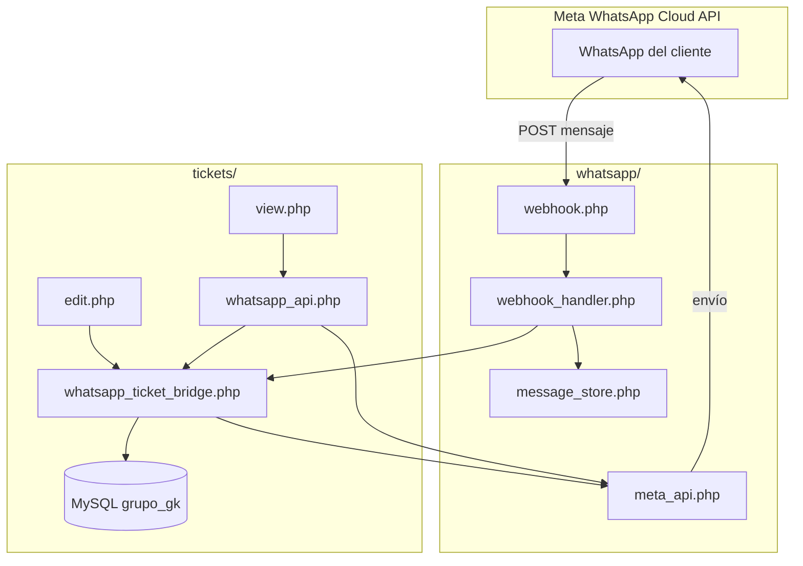
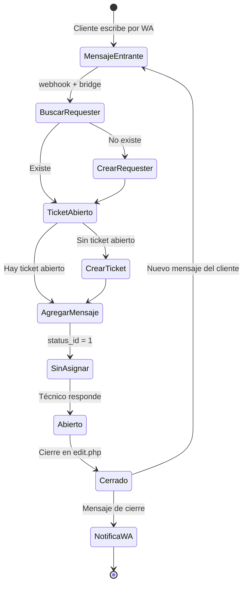

# Integración WhatsApp + Tickets — Documentación

Este documento describe el funcionamiento completo del módulo **WhatsApp** y su integración con el módulo **Tickets** de SecuriTI: recepción de mensajes, creación automática de tickets, conversación en `view.php` y respuestas por WhatsApp.

---

## Índice

1. [Resumen general](#resumen-general)
2. [Arquitectura](#arquitectura)
3. [Flujos de funcionamiento](#flujos-de-funcionamiento)
4. [Cambios en la base de datos](#cambios-en-la-base-de-datos)
5. [Configuración (.env)](#configuración-env)
6. [Archivos del módulo WhatsApp](#archivos-del-módulo-whatsapp)
7. [Archivos de integración con Tickets](#archivos-de-integración-con-tickets)
8. [Almacenamiento local](#almacenamiento-local)
9. [URLs y pruebas](#urls-y-pruebas)
10. [Reglas de negocio](#reglas-de-negocio)

---

## Resumen general

| Capacidad | Descripción |
|-----------|-------------|
| Webhook Meta | Recibe mensajes entrantes de WhatsApp Cloud API |
| Chat local | Panel de pruebas y sincronización de mensajes (`chat.php`) |
| Tickets automáticos | Cada mensaje entrante abre o continúa un ticket |
| Requesters | Busca por teléfono; si no existe, crea solicitante nuevo |
| Un ticket = una conversación | Hasta que el ticket se cierre |
| Nuevo mensaje tras cierre | Crea un ticket nuevo |
| Vista de ticket | Muestra hilo WhatsApp y permite responder (texto, imagen, audio) |
| Cierre de ticket | Notifica al cliente por WhatsApp desde `edit.php` |

---

## Arquitectura



---

## Flujos de funcionamiento

### 1. Mensaje entrante (cliente → sistema)

1. Meta envía un **POST** a `whatsapp/webhook.php`.
2. `webhook_handler.php` valida la firma (si `WHATSAPP_APP_SECRET` está configurado).
3. El payload JSON se guarda en `whatsapp/storage/incoming/`.
4. Se parsean los mensajes con `whatsappParseIncomingMessages()`.
5. Cada mensaje se guarda en el chat local (`messages.jsonl`) vía `whatsappChatSaveFromWebhook()`.
6. Se llama a **`ticketsWhatsappProcessInbound()`** (puente con tickets):
   - Normaliza el teléfono (solo dígitos).
   - Evita duplicados por `message_id` (wamid de Meta).
   - Busca **requester** por teléfono.
   - Si no existe → crea uno con email `wa_{teléfono}@whatsapp.local`.
   - Busca **ticket abierto** del solicitante (`closed_at` vacío y `status_id ≠ 3`).
   - Si no hay ticket abierto → **crea ticket nuevo** (modo contacto WhatsApp).
   - Inserta fila en **`ticket_messages`** con `is_whatsapp = 1`.
   - Si hay imagen/audio → descarga media de Meta y guarda adjunto en `ticket_attachments`.

### 2. Respuesta desde el ticket (técnico → cliente)

1. El técnico abre `tickets/modules/tickets/view.php?id={ticket}`.
2. Si el ticket es de WhatsApp, ve el hilo y el composer (texto / imagen / audio).
3. El JavaScript (`ticket-whatsapp.js`) llama a `whatsapp_api.php?action=send`.
4. `ticketsWhatsappSendFromTechnician()`:
   - Envía por Meta API (`whatsappSendTextMessage`, `whatsappSendImageMessage`, etc.).
   - Guarda el mensaje en `ticket_messages` (`sender_type = technician`, `is_whatsapp = 1`).
   - Opcionalmente copia adjuntos al almacén del ticket.
   - Actualiza `status_id` de 1 → 2 si el ticket estaba sin asignar/atender.

### 3. Actualización en tiempo real en la vista

- `ticket-whatsapp.js` hace **polling cada 5 segundos** a `whatsapp_api.php?action=messages`.
- Solo trae mensajes nuevos (`since_id`) para no recargar toda la página.

### 4. Cierre de ticket

1. En `edit.php`, al marcar el ticket como cerrado.
2. Se envía el correo de cierre (comportamiento existente).
3. **`ticketsWhatsappNotifyTicketClosed()`** envía un WhatsApp al teléfono del solicitante informando que el ticket fue cerrado y que puede escribir de nuevo para abrir uno nuevo.

### 5. Sincronización del panel de chat (`chat.php`)

- Al abrir o actualizar el panel WhatsApp Lab, se ejecuta `whatsappChatSyncIncoming()`.
- Reprocesa archivos JSON en `storage/incoming/` e importa mensajes al chat local sin duplicar.
- La sección **Últimos recibidos** muestra mensajes entrantes recientes.

---

## Cambios en la base de datos

Base de datos: **`grupo_gk`**

### Script SQL manual

Archivo: `tickets/sql/alter_ticket_messages_add_whatsapp.sql`

```sql
ALTER TABLE `ticket_messages`
    ADD COLUMN `is_whatsapp` TINYINT(1) NOT NULL DEFAULT 0 AFTER `is_email`,
    ADD COLUMN `whatsapp_type` VARCHAR(32) DEFAULT NULL AFTER `is_whatsapp`;

INSERT INTO `contact_modes` (`name`)
SELECT 'WhatsApp'
WHERE NOT EXISTS (SELECT 1 FROM `contact_modes` WHERE LOWER(`name`) LIKE '%whatsapp%');
```

### Migración automática

Si no ejecutas el SQL manualmente, **`ticketsWhatsappEnsureSchema()`** (en `whatsapp_ticket_bridge.php`) intenta crear las columnas y el modo de contacto la primera vez que procesa un mensaje.

### Tablas y columnas afectadas

| Tabla | Columna / cambio | Uso |
|-------|------------------|-----|
| `ticket_messages` | `is_whatsapp` TINYINT(1) DEFAULT 0 | Marca mensajes del canal WhatsApp |
| `ticket_messages` | `whatsapp_type` VARCHAR(32) | Tipo Meta: `text`, `image`, `audio`, `document`, etc. |
| `ticket_messages` | `message_id` (existente) | Guarda el **wamid** de Meta; clave anti-duplicados |
| `tickets` | `last_wa_message_id` (existente en migraciones previas) | Último wamid procesado en el ticket |
| `tickets` | `contact_mode_id` | Se asigna al modo **WhatsApp** al crear ticket desde webhook |
| `contact_modes` | fila `WhatsApp` | Catálogo de modo de contacto |
| `requesters` | `phone` (existente) | Búsqueda y creación de solicitantes por número |
| `ticket_attachments` | (sin cambios de esquema) | Imágenes/audios descargados de WhatsApp |

### Columnas que ya existían y se reutilizan

- `tickets.requester_id`, `tickets.status_id`, `tickets.closed_at`, `tickets.ticket_number`, `tickets.id_empresa`
- `ticket_messages.sender_type`, `sender_id`, `sender_name`, `sender_email`, `message`, `is_email`

### Valores de estado relevantes (`statuses`)

| id | Nombre | Significado en integración |
|----|--------|----------------------------|
| 1 | Sin Asignar | Ticket recién creado por WhatsApp |
| 2 | Abierto | Tras primera respuesta del técnico |
| 3 | Cerrado | No recibe más mensajes; el siguiente WhatsApp crea ticket nuevo |

---

## Configuración (.env)

Archivo: `whatsapp/.env` (no versionado; plantilla en `whatsapp/.env.example`)

| Variable | Obligatoria | Función |
|----------|-------------|---------|
| `WHATSAPP_APP_ID` | Recomendada | ID de la app en Meta Developers |
| `WHATSAPP_ACCESS_TOKEN` | **Sí** | Token para Graph API (envío y descarga de media) |
| `WHATSAPP_PHONE_NUMBER_ID` | **Sí** | ID del número de WhatsApp Business |
| `WHATSAPP_BUSINESS_ACCOUNT_ID` | Recomendada | ID de cuenta Business |
| `WHATSAPP_VERIFY_TOKEN` | **Sí** | Token que configuras en Meta para verificar el webhook (GET) |
| `WHATSAPP_APP_SECRET` | Opcional | Valida firma `X-Hub-Signature-256` en POST |
| `WHATSAPP_GRAPH_API_VERSION` | Opcional | Default `v22.0` |
| `WHATSAPP_DEFAULT_EMPRESA_ID` | Multi-empresa | `id_empresa` para tickets/requesters creados por WhatsApp |
| `WHATSAPP_CONTACT_MODE_ID` | Opcional | Fuerza un `contact_mode_id` fijo; si no, busca nombre "WhatsApp" |

### Webhook en Meta Developers

- **URL producción:** `https://TU-DOMINIO/whatsapp/webhook.php`
- **URL local (XAMPP):** `http://localhost:90/GK/whatsapp/webhook.php` (requiere túnel tipo ngrok para pruebas reales desde Meta)
- **Campo suscrito:** `messages` (no solo `message_template_status_update`)

---

## Archivos del módulo WhatsApp

Ruta base: `whatsapp/`

### Entrada HTTP

| Archivo | Función |
|---------|---------|
| `webhook.php` | Punto de entrada del webhook Meta. GET = verificación; POST = mensajes entrantes. |
| `chat.php` | Panel web "WhatsApp Lab": conversaciones, pruebas, sincronización. Requiere login (`auth.php`). |
| `status.php` | Página simple de estado de configuración. |
| `test_webhook.php` | Suite de 17 pruebas (CLI o navegador): webhook, storage, Meta API, chat. |

### API interna del chat

| Archivo | Función |
|---------|---------|
| `api/chat.php` | API JSON autenticada: `status`, `conversations`, `messages`, `send`, `sync`, `recent_inbound`, `serve` (media), `simulate`, `tests`. |

### Includes (lógica PHP)

| Archivo | Función |
|---------|---------|
| `includes/bootstrap.php` | Define rutas (`WHATSAPP_ROOT`, `WHATSAPP_STORAGE`, etc.), carga `.env`, crea directorios. |
| `includes/config.php` | `whatsappConfig()`, `whatsappIsConfigured()`, `whatsappGraphUrl()`. |
| `includes/logger.php` | Escribe en `storage/logs/whatsapp.log` y guarda payloads en `storage/incoming/`. |
| `includes/webhook_handler.php` | Verificación GET, validación de firma, parseo de payload Meta, guardado en chat y **llamada al puente de tickets**. |
| `includes/message_store.php` | Almacén local JSONL: guardar/cargar mensajes, deduplicación por `message_id`, sync desde `incoming/`, descarga de media. |
| `includes/meta_api.php` | Cliente Graph API: enviar texto/imagen/audio, subir y descargar media. |
| `includes/test_suite.php` | Pruebas automatizadas usadas por `test_webhook.php`. |

### Frontend del chat de pruebas

| Archivo | Función |
|---------|---------|
| `css/chat.css` | Estilos del panel WhatsApp Lab. |
| `js/chat.js` | Lógica del panel: API, conversaciones, últimos recibidos, envío, polling. |

### Pruebas de integración

| Archivo | Función |
|---------|---------|
| `test_ticket_bridge.php` | Verifica esquema BD y prueba `ticketsWhatsappProcessInbound()` con un payload guardado. |

### Configuración y datos locales

| Archivo / carpeta | Función |
|-------------------|---------|
| `.env` | Credenciales reales (gitignored). |
| `.env.example` | Plantilla de variables de entorno. |
| `storage/chat/messages.jsonl` | Historial local de mensajes del chat de pruebas. |
| `storage/chat/imported_message_ids.json` | Índice anti-duplicados por wamid. |
| `storage/chat/media/` | Archivos multimedia descargados de Meta. |
| `storage/incoming/*.json` | Payload crudo de cada webhook recibido. |
| `storage/logs/whatsapp.log` | Log de eventos del módulo. |
| `storage/chat/ticket_links.json` | Archivo legacy de pruebas; la integración real usa MySQL (`ticket_messages`). |

---

## Archivos de integración con Tickets

Ruta base: `tickets/`

### Núcleo de la integración

| Archivo | Función |
|---------|---------|
| `includes/whatsapp_ticket_bridge.php` | **Puente principal.** Funciones: buscar/crear requester por teléfono, buscar ticket abierto, crear ticket, insertar mensajes WA, enviar respuestas del técnico, notificar cierre, migración automática de esquema. |

Funciones principales:

| Función | Descripción |
|---------|-------------|
| `ticketsWhatsappProcessInbound()` | Procesa mensaje entrante → requester → ticket → `ticket_messages` |
| `ticketsWhatsappFindOrCreateRequester()` | Busca por teléfono o crea solicitante |
| `ticketsWhatsappFindOpenTicket()` | Ticket abierto del solicitante o `null` |
| `ticketsWhatsappCreateTicket()` | Nuevo ticket con modo WhatsApp |
| `ticketsWhatsappInsertMessage()` | Inserta en `ticket_messages` con flags WA |
| `ticketsWhatsappSendFromTechnician()` | Envía por Meta y guarda respuesta del técnico |
| `ticketsWhatsappNotifyTicketClosed()` | WhatsApp al cerrar ticket |
| `ticketsWhatsappIsTicket()` | Detecta si un ticket es de canal WhatsApp |
| `ticketsWhatsappEnsureSchema()` | Crea columnas/catálogo si faltan |

### Vista y API del ticket

| Archivo | Función |
|---------|---------|
| `modules/tickets/view.php` | **Modificado.** Detecta ticket WhatsApp, muestra hilo con burbujas, composer WA (texto/imagen/audio), oculta formulario de correo en tickets WA. |
| `modules/tickets/whatsapp_api.php` | API JSON autenticada para la vista: `send` (responder) y `messages` (polling). |
| `modules/tickets/js/ticket-whatsapp.js` | Envío, adjuntos y polling en la vista del ticket. |
| `modules/tickets/css/ticket-whatsapp.css` | Estilos del hilo y composer WhatsApp en `view.php`. |

### Cierre de ticket

| Archivo | Función |
|---------|---------|
| `modules/tickets/edit.php` | **Modificado.** Al cerrar ticket llama a `ticketsWhatsappNotifyTicketClosed()`. |

### SQL

| Archivo | Función |
|---------|---------|
| `sql/alter_ticket_messages_add_whatsapp.sql` | Script manual de migración (`is_whatsapp`, `whatsapp_type`, catálogo WhatsApp). |

### Dependencias del puente (sin modificar)

| Archivo | Uso en integración |
|---------|-------------------|
| `includes/ticket_counter_helper.php` | `getNextTicketNumber()`, `getNextRequesterNumber()` |
| `includes/ticket_history.php` | `logTicketCreated()` al crear ticket por WhatsApp |
| `conexion/db.php` | Conexión MySQL |
| `includes/ticket_display_helper.php` | Helpers de visualización en vista (sin cambios WA directos) |

---

## Almacenamiento local

```
whatsapp/
├── storage/
│   ├── incoming/          # Payload JSON de cada webhook
│   ├── logs/              # whatsapp.log
│   └── chat/
│       ├── messages.jsonl           # Chat local (panel de pruebas)
│       ├── imported_message_ids.json
│       └── media/                   # Media descargada de Meta
```

**Importante:** Los mensajes oficiales del ticket viven en **MySQL** (`ticket_messages`). El JSONL es complementario para el panel `chat.php` y depuración.

---

## URLs y pruebas

| Recurso | URL (XAMPP local) |
|---------|-------------------|
| Webhook | `http://localhost:90/GK/whatsapp/webhook.php` |
| Panel chat / pruebas | `http://localhost:90/GK/whatsapp/chat.php` |
| Vista ticket | `http://localhost/tickets/modules/tickets/view.php?id={id}` |
| Suite pruebas webhook | `php whatsapp/test_webhook.php http://localhost` |
| Prueba puente tickets | `php whatsapp/test_ticket_bridge.php` |

### Checklist de puesta en marcha

1. Copiar `whatsapp/.env.example` → `whatsapp/.env` y completar credenciales Meta.
2. Configurar webhook en Meta Developers (URL + verify token + suscripción `messages`).
3. Opcional: ejecutar `tickets/sql/alter_ticket_messages_add_whatsapp.sql` (o dejar migración automática).
4. Configurar `WHATSAPP_DEFAULT_EMPRESA_ID` si usas multi-empresa.
5. Ejecutar `php whatsapp/test_webhook.php http://localhost` → esperar **17/17 OK**.
6. Enviar mensaje de prueba real o simular desde el panel.
7. Abrir el ticket creado, asignar técnico y responder por WhatsApp desde `view.php`.

---

## Reglas de negocio

### Teléfono y solicitantes

- Los teléfonos se comparan **solo con dígitos** (`whatsappChatNormalizePhone`).
- También se comparan los **últimos 10 dígitos** para tolerar variaciones de prefijo país.
- Email del requester auto-creado: `wa_{teléfono}@whatsapp.local` (la columna `email` es obligatoria en BD).

### Tickets

- **Un ticket abierto por solicitante:** todos los WhatsApp del mismo número van al mismo ticket hasta cerrarlo.
- **Ticket cerrado** (`status_id = 3` o `closed_at` definido): el siguiente mensaje crea **nuevo ticket**.
- **Sin ticket duplicado:** si ya existe abierto, solo se agrega mensaje a `ticket_messages`.
- **Anti-duplicados:** el `message_id` (wamid) no se inserta dos veces en `ticket_messages`.

### Respuestas del técnico

- Requiere **técnico asignado** al ticket (igual que respuestas por correo).
- Soporta **texto**, **imagen** y **audio** vía Meta Cloud API.
- Al responder, el ticket puede pasar de estado 1 → 2.

### Detección de “ticket WhatsApp” en la vista

Un ticket se trata como WhatsApp si cumple alguna de:

- `contact_mode` contiene "WhatsApp"
- `last_wa_message_id` tiene valor
- Existe al menos un mensaje con `is_whatsapp = 1`

---

## Diagrama: ciclo de vida del ticket WhatsApp



---

## Notas adicionales

- El archivo legacy `tickets/what.php` **no forma parte** de esta integración; usar solo `whatsapp/webhook.php`.
- Los archivos en `storage/` (logs, incoming, messages.jsonl, media) están en `.gitignore`.
- En producción se recomienda configurar `WHATSAPP_APP_SECRET` para validar la firma del webhook.
- DocumentRoot de Apache debe apuntar a la raíz del proyecto (`htdocs-securiti`), por lo que las URLs correctas son `/whatsapp/...` y `/tickets/...` (sin `/htdocs-securiti/` en la ruta).

---

*Documento generado para el proyecto SecuriTI — integración WhatsApp + Tickets.*
